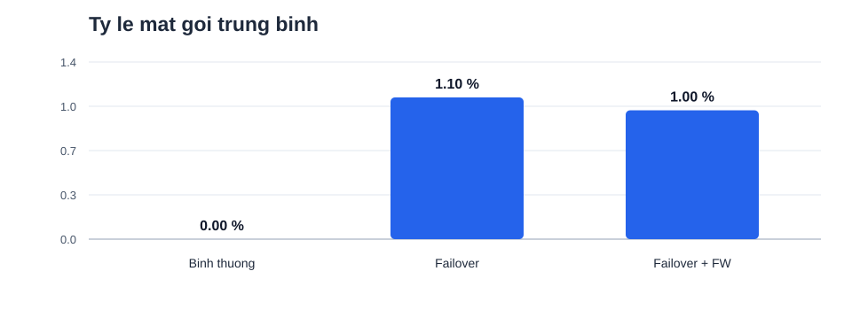
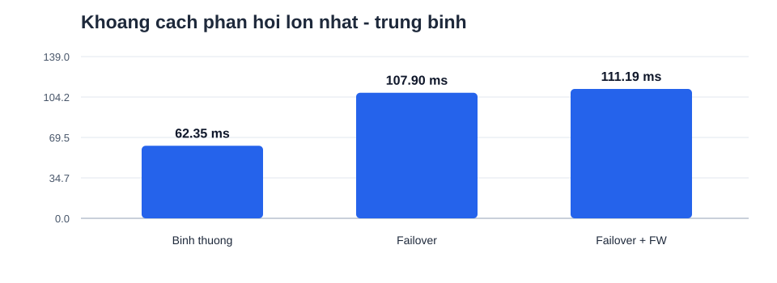

# So sánh ba kịch bản SRv6 - số liệu thực nghiệm

| Kịch bản | Số lần đo | Mất gói TB | Max reply gap TB | Max reply gap lớn nhất |
|---|---:|---:|---:|---:|
| Mang binh thuong | 10 | 0.00% | 62.35 ms | 80.83 ms |
| SRv6 + Python failover | 10 | 1.10% | 107.90 ms | 154.33 ms |
| SRv6 + Firewall failover | 10 | 1.00% | 111.19 ms | 154.91 ms |

## Nguồn dữ liệu

- Mang binh thuong: `results/normal_control/summary.csv`
- SRv6 + Python failover: `results/batch_20261030_234548/summary.csv`
- SRv6 + Firewall failover: `results/fw_continuous_20261031_012921/summary.csv`

## Giới hạn diễn giải

- `max_reply_gap_ms` là khoảng giữa hai phản hồi ICMP liên tiếp; không phải thời gian chuyển mạch TI-LFA.
- Kịch bản thường/không Firewall chạy trên `srv6-tilfa5`; kịch bản Firewall chạy trên `srv6-fw` với topology khác, nên so sánh mang tính tham khảo, chưa phải thí nghiệm cùng một topology với duy nhất biến Firewall.
- Các thí nghiệm sử dụng SRv6 static steering và failover Python; không chứng minh TI-LFA chuẩn RFC 9855 hay bảo vệ dưới 50 ms.
- Kiểm tra độ đồng nhất của chu kỳ ping, số gói, tải VM và tuyến phản hồi trước khi diễn giải khác biệt như tác động Firewall.

## Biểu đồ

